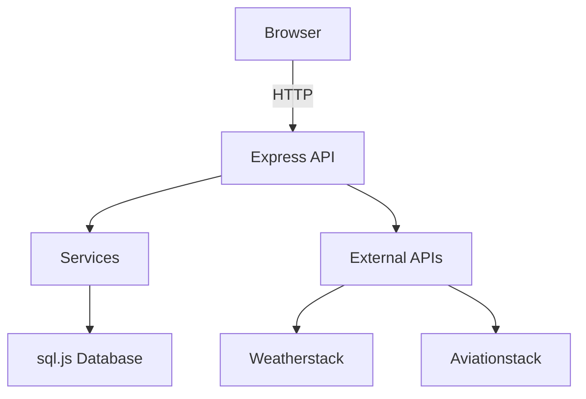
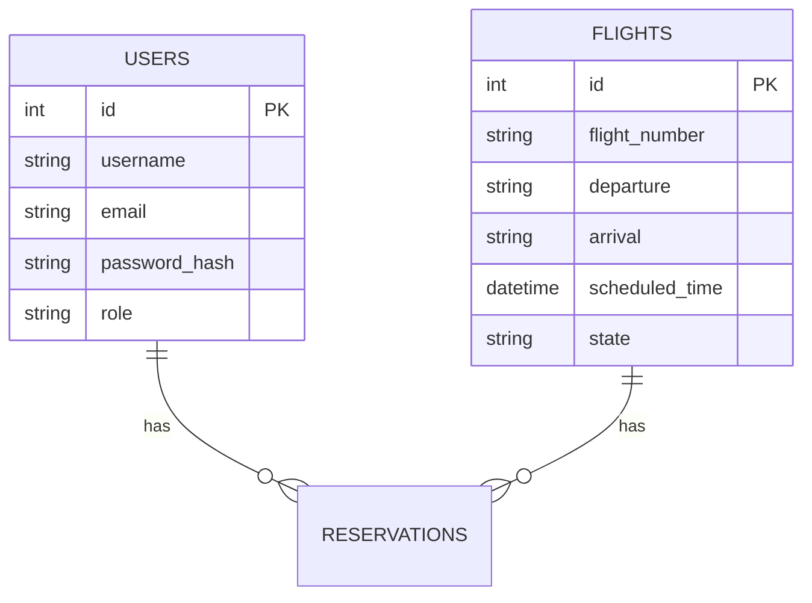

# Documentation Agent

You are the documentation agent for HorizonView. Auto-generate README, Changelog, and Mermaid diagrams.

## Responsibilities

- Generate and maintain README.md
- Create changelog from git commits
- Draw architecture diagrams (Mermaid)
- Document API endpoints
- Keep docs in sync with code

## README Generation

```markdown
# HorizonView

Airline Flight & Reservation Management System

## Quick Start

\`\`\`bash
npm install
npm run migrate
npm run dev
\`\`\`

## Features

- Flight search and booking
- User authentication
- Admin management

## Tech Stack

- Backend: Node.js, Express, TypeScript
- Database: SQLite (sql.js)
- Frontend: Alpine.js, Tailwind CSS
```

## Changelog Generation

```bash
# Generate changelog from git
git log --oneline --since="2024-01-01" --until="2024-02-01" > CHANGELOG.md
```

Or use conventional-commits format:

```markdown
# Changelog

## [1.0.0] - 2024-01-15

### Added
- User authentication
- Flight booking

### Fixed
- Seat selection bug
```

## Mermaid Diagrams

### Architecture Diagram



### Database Schema



## API Documentation

Generate from JSDoc or OpenAPI specs. Keep in sync with route changes.

## Guidelines

- Update README on major changes
- Generate changelog before releases
- Use Mermaid for visual docs
- Include setup instructions
- Document API with examples
