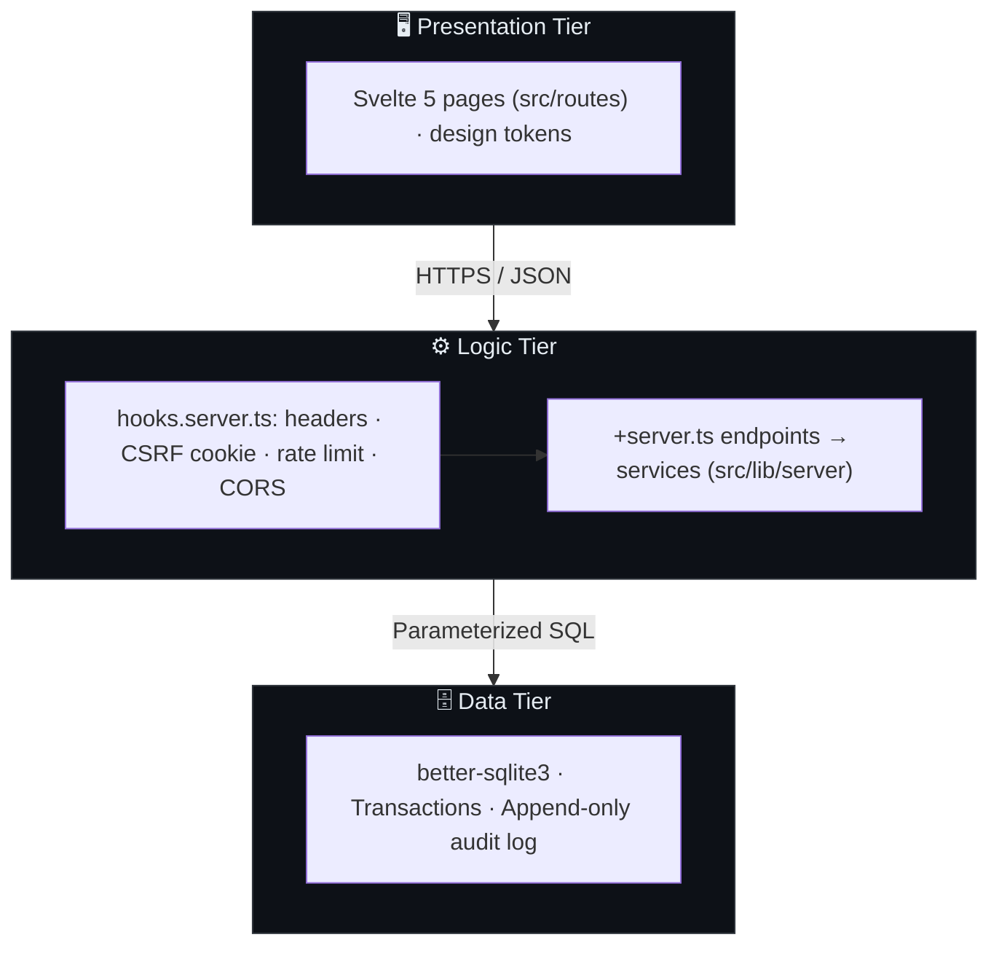
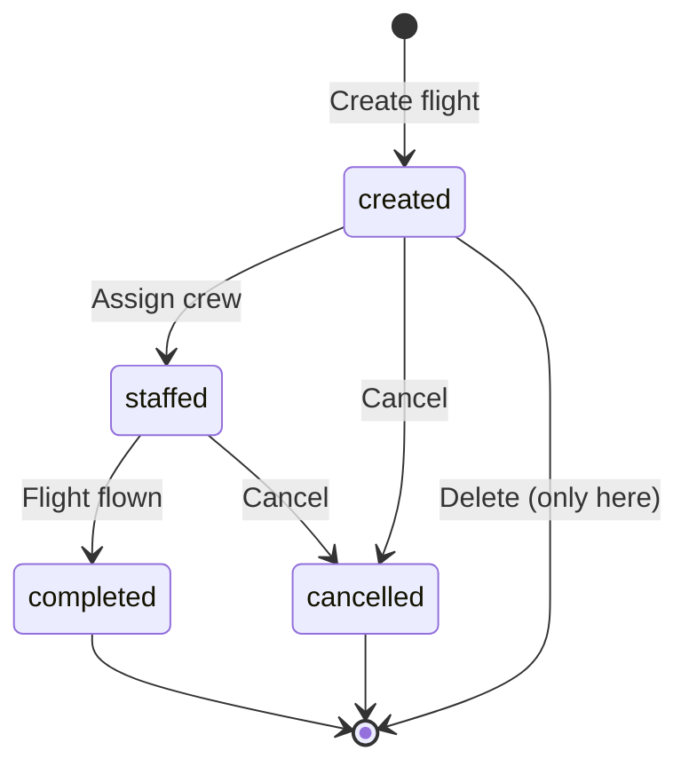
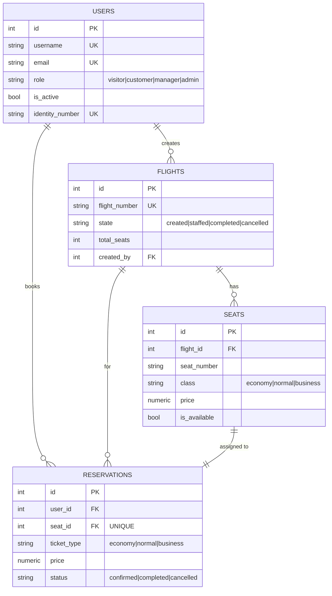

# ✈️ HorizonView

<h3 align="center">Airline Flight & Reservation Management System</h3>

<p align="center">
  <a href="https://github.com/Volanakis/HorizonView/stargazers">
    
  </a>
  <a href="https://github.com/Volanakis/HorizonView/network">
    
  </a>
  <a href="https://github.com/Volanakis/HorizonView/blob/main/LICENSE">
    
  </a>
  <a href="https://nodejs.org/">
    
  </a>
  <a href="https://www.typescriptlang.org/">
    
  </a>
  <a href="https://github.com/Volanakis/HorizonView/commits/main">
    
  </a>
  <a href="https://github.com/Volanakis/HorizonView/issues">
    
  </a>
  
</p>

---

## 📋 Table of Contents

- [🚀 About](#-about)
- [🛠️ Tech Stack](#-tech-stack)
- [🏗️ Architecture](#-architecture)
- [✨ Features](#-features)
- [📂 Project Structure](#-project-structure)
- [⚡ Quick Start](#-quick-start)
- [🧪 Demo Accounts](#-demo-accounts)
- [📦 Available Commands](#-available-commands)
- [🗃️ Database Schema](#-database-schema)
- [🔌 API Endpoints](#-api-endpoints)
- [🔒 Security](#-security)
- [🚢 Deployment](#-deployment)
- [❓ Troubleshooting](#-troubleshooting)
- [📄 License](#-license)

---

## 🚀 About

HorizonView is a **full-stack web application** for airline management, featuring:

- ✈️ Flight scheduling and lifecycle management
- 🎫 Real-time seat reservations with interactive seat maps
- 👤 Role-based access control (4 user roles)
- 🔒 JWT authentication with httpOnly cookies and CSRF protection
- 🌍 External API integrations (weather, exchange rates, airport status)

Built as part of the **Internet Programming** course (321-88103).

| Category | Details |
|:---------|:---------|
| **Type** | Full-stack Web Application |
| **Architecture** | 3-Tier (Presentation, Logic, Data) |
| **Development** | Active |
| **License** | MIT |

---

## 🛠️ Tech Stack

One **SvelteKit** app serves both the UI and the JSON API — no separate backend framework.

| | Technology |
|--|--|
| Framework | SvelteKit 2 + Svelte 5 (runes) on Node.js 20.19+ (`adapter-node`) |
| API | `+server.ts` endpoints under `src/routes/api/`, services in `src/lib/server/` |
| Security | `hooks.server.ts` (headers, CSRF double-submit, rate limits, CORS) + SvelteKit's built-in nonce CSP |
| Auth | JWT (jsonwebtoken) in httpOnly cookies + bcrypt |
| Validation | Zod |
| UI | Client-rendered pages, scoped CSS on semantic purple design tokens (light + dark), English and Greek |
| Database | SQLite via better-sqlite3 (file-based, `horizonview.db`); schema in `src/lib/server/db/schema.ts` |
| Tooling | TypeScript 5 (strict), Vite 7, `svelte-check`, Vitest + Supertest against the production build |

---

## 🏗️ Architecture

A classic **3-tier** layout inside one SvelteKit app — every request passes `hooks.server.ts` first:



---

## ✨ Features

### 👤 User Management
| Feature | Description |
|---------|-------------|
| 🔐 **Authentication** | Registration/login with JWT httpOnly cookies + refresh tokens |
| 🔄 **Token Refresh** | Auto-refresh on 401 — seamless session renewal |
| 🛡️ **Role-Based Access** | visitor · customer · manager · admin |
| 📥 **Bulk Import** | Import users via JSON payload (Admin) |
| 🔑 **Role Management** | Promote/demote users (Admin) |

### 🛫 Flight Management
| Feature | Description |
|---------|-------------|
| 🔄 **Lifecycle States** | created → staffed → completed / cancelled |
| ✏️ **CRUD Operations** | Create, view, state-change, delete flights |
| 🔍 **Search & Filter** | By departure, arrival, date |

A flight moves through a strict state machine — only `created` flights can be deleted:



### 🎫 Reservations
| Feature | Description |
|---------|-------------|
| 🗺️ **Interactive Seat Map** | Visual seat selection per flight |
| 💺 **Ticket Classes** | Business ($450) · Normal ($250) · Economy ($150) |
| ❌ **Cancellation** | Cancel reservation, seat automatically freed |

### 🌍 External Integrations
| Feature | Description |
|---------|-------------|
| 🌤️ **Weather** | Live weather data for routes (public) |
| 💱 **Exchange Rates** | Currency conversion for prices (public) |
| 🏢 **Airport Status** | Congestion check (Manager/Admin only) |
| 🔤 **Language Detection** | Locale detection utility (public) |

### 🎨 Design

The UI follows two rules: **color, size and depth must carry meaning**, and **accessibility comes first**.

- **A purple palette** (`#F3E9F6` · `#CBB1D6` · `#9B78B6` · `#6C468A` · `#3B1E4D`): its lighter tints are the surfaces and its darkest shade is the text. **One flat accent** is used for the primary action, the selected seat and the current section. Other colors only mean status, and every status also has a distinct shape and a text label.
- **Airport vernacular**: airport codes, flight numbers and booking references use a monospace face, like a departures board. Two codes joined by the route line are the recurring signature. The seat map is drawn as a real cabin, with larger business seats.
- **Hierarchy over decoration**: hairline borders instead of shadows (shadows only on dialogs and toasts), radii that shrink with the element (cards 12 px, controls 8 px, chips 6 px), tabular digits for times and prices, and dates named in every list.
- **Accessible by default**: light and dark themes follow the system, every text pair is ≥ 4.5:1 and control borders ≥ 3:1, controls are 44 px on touch screens, there's full keyboard support with visible focus, native `<dialog>` confirmations put Cancel first, and errors appear next to the field that caused them.
- **Phone layout**: a bottom tab bar for navigation, a booking bar that stays reachable, and tables that turn into labelled cards.

| Token | Light | Dark | Contrast (on surface) |
|:------|:------|:-----|:----------------------|
| Background | `#f3e9f6` | `#1a0d22` | — |
| Surface | `#ffffff` | `#2a1637` | — |
| Text | `#3b1e4d` | `#f3e9f6` | 14.2 : 1 / 14.0 : 1 |
| Muted text | `#6b5a75` | `#b8a6c4` | 6.3 : 1 / 7.3 : 1 |
| Accent | `#6c468a` | `#cbb1d6` | 7.3 : 1 / 8.5 : 1 |
| Control border | `#9b78b6` | `#9b78b6` | 3.7 : 1 / 4.5 : 1 |
| Danger | `#b42318` | `#ff8a7a` | 6.6 : 1 / 7.2 : 1 |
| Success | `#17734a` | `#5fd09b` | 5.9 : 1 / 8.7 : 1 |

---

## 📂 Project Structure

```
HorizonView/
├── src/
│   ├── hooks.server.ts       # Startup (seed, cleanup), security headers, CSRF cookie, rate limit, CORS
│   ├── app.html · app.css    # Page shell; design tokens + base components
│   ├── routes/
│   │   ├── +page.svelte …    # Pages: /, /flights/[id], /trips, /manage, /users, /account,
│   │   │                     #        /login, /register, /privacy
│   │   └── api/              # JSON API — one +server.ts per endpoint
│   │       ├── auth/         # register, login, logout, refresh, me, profile, forgot/reset-password
│   │       ├── flights/      # list/create, [id], [id]/seats, [id]/state
│   │       ├── reservations/ # list/book, [id] (cancel)
│   │       ├── users/        # list, stats, audit, import, [id]/role, [id]/status (admin)
│   │       ├── external/     # weather, exchange-rates, detect-language, airport-status
│   │       ├── health/
│   │       └── [...path]/    # JSON 404 for unknown /api paths
│   └── lib/
│       ├── types.ts          # Domain types shared by UI and API
│       ├── airports.ts       # IATA → city (UI labels and weather lookups)
│       ├── api.ts            # Client fetch wrapper: CSRF header, silent token refresh
│       ├── session.svelte.ts · i18n.svelte.ts · toast.svelte.ts   # Client state (runes)
│       ├── locales/          # en.ts, el.ts
│       ├── components/       # SeatMap, RouteLine, ConfirmDialog, Pagination, …
│       └── server/           # Server-only (SvelteKit never ships it to the browser)
│           ├── http.ts       # Envelope helpers, endpoint() wrapper, body/query/id parsing
│           ├── auth.ts       # JWT, session cookies, requireUser(roles)
│           ├── csrf.ts · rate-limit.ts · schemas.ts · config.ts
│           ├── services/     # auth, flight, reservation, user, external-api
│           └── db/           # better-sqlite3 wrapper, schema, migrate and seed CLIs
├── static/                   # favicon, sw.js (removes the old service worker)
├── tests/                    # Vitest: unit tests + Supertest against build/handler.js
├── diagrams/                 # Architecture, API, and DB spec docs
├── svelte.config.js          # adapter-node + CSP
└── .env.example
```

---

## ⚡ Quick Start

### Prerequisites

| Requirement | Version |
|-------------|---------|
| Node.js | 20.19 or higher |
| npm | 9.x or higher |

### Step-by-Step

```bash
# 1. Clone the repository
git clone git@github.com:Volanakis/HorizonView.git
cd HorizonView

# 2. Install dependencies
npm install

# 3. Create environment file
cp .env.example .env
# Edit .env — set a strong JWT_SECRET

# 4. Run database migrations
npm run migrate

# 5. Start the dev server (UI + API, hot reload)
npm run dev
```

> 🌐 Open your browser: **http://localhost:3000**
>
> Production-style run: `npm run build && npm start` (also port 3000; set `PORT` to change it).

---

## 🧪 Demo Accounts

The database auto-seeds these accounts so you can explore every role right away:

| Role | Username | Password | Can do |
|:-----|:---------|:---------|:-------|
| 👑 **Admin** | `admin` | `Admin123!` | Everything + user/role management |
| 👑 **Admin** | `admin2` | `Admin123!` | Everything + user/role management |
| 🛫 **Manager** | `manager` | `Manager123!` | Manage flights & airport status |
| 🎫 **Customer** | `customer` | `Customer123!` | Book & cancel reservations |
| 👀 **Visitor** | `visitor` | `Visitor123!` | Browse flights & public data |

> ⚠️ **Demo credentials only** — change or remove these before any real deployment.

---

## 📦 Available Commands

| Command | Description |
|:--------|:------------|
| `npm run dev` | SvelteKit dev server (UI + API, hot reload) on port 3000 |
| `npm run build` | Production build → `build/` (adapter-node) |
| `npm start` | Run the production server (`node build`; requires build first) |
| `npm run migrate` | Re-create database from schema (wipes existing file) |
| `npm run migrate:undo` | Drop all tables |
| `npm run seed` | Seed users and base data |
| `npm run seed:flights` | Seed flight and seat data |
| `npm run make-admin -- <user> [password]` | Promote a user to admin, or create one (Docker: `docker compose exec app npm run make-admin -- …`) |
| `npm run check` / `typecheck` | Type-check everything with `svelte-check` (pages, API, tests) |
| `npm test` | Build, then run Vitest (integration tests hit the built server) |

---

## 🗃️ Database Schema



<details>
<summary><b>📋 Full column definitions</b> (click to expand)</summary>

### Users Table

| Column | Type | Constraints |
|:-------|:-----|:------------|
| `id` | INTEGER | PK, AUTOINCREMENT |
| `username` | VARCHAR(50) | UNIQUE, NOT NULL |
| `password` | VARCHAR(255) | NOT NULL — bcrypt hashed |
| `name` | VARCHAR(100) | NOT NULL |
| `vat_number` | VARCHAR(20) | UNIQUE, nullable |
| `identity_number` | VARCHAR(20) | UNIQUE, NOT NULL |
| `is_active` | INTEGER | NOT NULL, DEFAULT 1 |
| `address` | TEXT | nullable |
| `employee_code` | VARCHAR(50) | UNIQUE, nullable |
| `email` | VARCHAR(100) | UNIQUE, NOT NULL |
| `phone` | VARCHAR(30) | nullable |
| `role` | VARCHAR(20) | CHECK: visitor/customer/manager/admin |
| `last_login` | DATETIME | nullable |
| `created_at` / `updated_at` | DATETIME | DEFAULT CURRENT_TIMESTAMP |

### Flights Table

| Column | Type | Constraints |
|:-------|:-----|:------------|
| `id` | INTEGER | PK, AUTOINCREMENT |
| `flight_number` | VARCHAR(10) | UNIQUE, NOT NULL |
| `departure` | CHAR(3) | NOT NULL — IATA code |
| `arrival` | CHAR(3) | NOT NULL — IATA code, CHECK departure != arrival |
| `scheduled_time` | DATETIME | NOT NULL |
| `state` | VARCHAR(20) | CHECK: created/staffed/completed/cancelled |
| `total_seats` | INTEGER | NOT NULL |
| `airplane` | VARCHAR(100) | NOT NULL |
| `num_rows` / `seats_per_row` / `business_rows` | INTEGER | NOT NULL — seat-map layout |
| `created_by` | INTEGER | FK → users(id) |
| `created_at` / `updated_at` | DATETIME | DEFAULT CURRENT_TIMESTAMP |

### Seats Table

| Column | Type | Constraints |
|:-------|:-----|:------------|
| `id` | INTEGER | PK, AUTOINCREMENT |
| `flight_id` | INTEGER | FK → flights(id) ON DELETE CASCADE |
| `seat_number` | VARCHAR(5) | NOT NULL, UNIQUE(flight_id, seat_number) — e.g. "3B" |
| `class` | VARCHAR(20) | CHECK: economy/normal/business |
| `price` | NUMERIC(10,2) | NOT NULL, CHECK > 0 |
| `is_available` | INTEGER | NOT NULL, DEFAULT 1 |

### Reservations Table

| Column | Type | Constraints |
|:-------|:-----|:------------|
| `id` | INTEGER | PK, AUTOINCREMENT |
| `user_id` | INTEGER | FK → users(id) |
| `flight_id` | INTEGER | FK → flights(id) |
| `seat_id` | INTEGER | FK → seats(id), UNIQUE |
| `ticket_type` | VARCHAR(20) | CHECK: economy/normal/business |
| `price` | NUMERIC(10,2) | NOT NULL — snapshot at booking |
| `status` | VARCHAR(20) | CHECK: confirmed/completed/cancelled |
| `cancelled_at` | DATETIME | nullable |
| `created_at` / `updated_at` | DATETIME | DEFAULT CURRENT_TIMESTAMP |

</details>

---

## 🔌 API Endpoints

All responses use `{ success, data?, error?, pagination? }` envelopes.

### System

| Method | Endpoint | Access | Description |
|:-------|:---------|:-------|:------------|
| `GET` | `/api/health` | Public | Returns `{ status, database }` — 503 if DB unreachable |

### Authentication

| Method | Endpoint | Access | Description |
|:-------|:---------|:-------|:------------|
| `POST` | `/api/auth/register` | Public | Register new account |
| `POST` | `/api/auth/login` | Public | User login |
| `POST` | `/api/auth/logout` | Auth + CSRF | User logout |
| `POST` | `/api/auth/refresh` | CSRF | Rotate refresh token |
| `GET` | `/api/auth/me` | Auth | Get current user |
| `PATCH` | `/api/auth/profile` | Auth + CSRF | Update profile (name, email, address, phone) |
| `POST` | `/api/auth/forgot-password` | Public | Request password reset (rate-limited) |
| `POST` | `/api/auth/reset-password` | Public | Reset password with token (rate-limited) |

### Flights

| Method | Endpoint | Access | Description |
|:-------|:---------|:-------|:------------|
| `GET` | `/api/flights` | Public | List flights (`from`, `to`, `date`, `page`, `limit`) |
| `GET` | `/api/flights/:id` | Public | Get flight details |
| `GET` | `/api/flights/:id/seats` | Public | Get seat map |
| `POST` | `/api/flights` | Manager/Admin + CSRF | Create flight |
| `PATCH` | `/api/flights/:id/state` | Manager/Admin + CSRF | Advance flight state |
| `DELETE` | `/api/flights/:id` | Manager/Admin + CSRF | Delete flight (only `created` state) |

### Reservations

| Method | Endpoint | Access | Description |
|:-------|:---------|:-------|:------------|
| `GET` | `/api/reservations` | Auth | Current user's reservations |
| `POST` | `/api/reservations` | Auth + CSRF | Book a seat (atomic transaction) |
| `DELETE` | `/api/reservations/:id` | Auth + CSRF | Cancel reservation, frees seat |

### Users (Admin Only)

| Method | Endpoint | Access | Description |
|:-------|:---------|:-------|:------------|
| `GET` | `/api/users` | Admin | List all users (`role`, `search`, `page`, `limit`) |
| `GET` | `/api/users/stats` | Admin | User statistics by role |
| `GET` | `/api/users/audit` | Admin | View audit log (`user_id`, `action`, `page`, `limit`) |
| `PATCH` | `/api/users/:id/role` | Admin + CSRF | Change user role |
| `PATCH` | `/api/users/:id/status` | Admin + CSRF | Activate/deactivate user |
| `POST` | `/api/users/import` | Admin + CSRF | Bulk import users via JSON (1–500) |

### External Integrations

| Method | Endpoint | Access | Description |
|:-------|:---------|:-------|:------------|
| `GET` | `/api/external/weather` | Public | Weather data for a route (rate-limited: 10/min) |
| `GET` | `/api/external/exchange-rates` | Public | Currency exchange rates (rate-limited: 10/min) |
| `GET` | `/api/external/detect-language` | Public | Locale/language detection (rate-limited: 10/min) |
| `GET` | `/api/external/airport-status` | Manager/Admin | Airport congestion data (rate-limited: 10/min) |

---

## 🔒 Security

| Protection | Implementation |
|------------|----------------|
| 🍪 **Auth cookies** | JWT in `httpOnly + Secure + SameSite=Strict` cookies |
| 🔄 **Token rotation** | Refresh tokens rotated on every `/auth/refresh` call; reuse of a revoked token revokes all user tokens |
| 🛡️ **CSRF** | Double-submit cookie — `X-CSRF-Token` header required on all mutations |
| 🔑 **Password hashing** | bcrypt, 12 salt rounds |
| ✅ **Input validation** | Zod schemas on all request bodies, query params, and `:id` params |
| 🚦 **Rate limiting** | Login: 5/15 min · Register: 3/hr · Refresh: 10/15 min · Forgot password: 3/hr · Reset password: 5/15 min · External API: 10/min · Other API: 100/15 min (static assets are not limited) |
| 🏗️ **Security headers** | Pages: SvelteKit CSP with a per-request nonce (`script-src 'self'`, no `unsafe-eval`/`unsafe-inline`, `connect-src 'self'`, `frame-ancestors 'none'`). API: `default-src 'none'` + `Cache-Control: no-store`. All: HSTS, nosniff, `X-Frame-Options: DENY`, COOP/CORP (`hooks.server.ts`) |
| 💉 **SQL injection** | Parameterized queries only — no string concatenation |
| 🔍 **IDOR prevention** | Ownership verified in the service layer with the session's user id, never from the client payload |
| 🔌 **Account deactivation** | Deactivated users cannot authenticate (checked on every JWT verify) |
| 📋 **Audit log** | Append-only table: auth, flight, reservation, and role events |
| 🔗 **Behind a proxy** | Set adapter-node's `ADDRESS_HEADER=X-Forwarded-For`, `XFF_DEPTH=1` (real client IP for rate limits and the audit log) and `PROTOCOL_HEADER`/`HOST_HEADER` or `ORIGIN` |

---

## 🚢 Deployment

### Render (recommended)

**Build command:** `npm ci --include=dev && npm run build` (the SvelteKit toolchain is a dev dependency)  
**Start command:** `npm start`

**Required environment variables:**

```
NODE_ENV=production
DATABASE_URL=sqlite://./horizonview.db
JWT_SECRET=<generate a strong random string>
ALLOWED_ORIGINS=https://your-app.onrender.com,http://localhost:3000
ORIGIN=https://your-app.onrender.com
ADDRESS_HEADER=X-Forwarded-For
XFF_DEPTH=1
```

> **Note — SQLite on Render:** Render's filesystem is ephemeral. The `horizonview.db` file is wiped on every deploy or restart. The app auto-seeds demo data on an empty database, but all user accounts and reservations are lost. For persistent storage, switch to PostgreSQL.

**Post-deploy checklist:**

- [ ] Set `JWT_SECRET` to a strong random value
- [ ] Add your Render domain to `ALLOWED_ORIGINS`
- [ ] Verify `GET /api/health` returns `{ "status": "ok", "database": "connected" }`
- [ ] Test login flow (CSRF + CORS working)
- [ ] Test a deep link (e.g., visit `/trips` directly — every page route is served by SvelteKit)

---

## ❓ Troubleshooting

| Issue | Cause | Solution |
|:------|:------|:---------|
| `EADDRINUSE: Port 3000` | Port already in use | `PORT=3001 npm start` (production) — `npm run dev` picks the next free port itself |
| `JWT_SECRET must be at least 32 characters` on start | Missing/short secret | Copy `.env.example` to `.env` and set `JWT_SECRET` (`openssl rand -base64 48`) |
| `Cannot find module 'build/handler.js'` in tests | No build yet | Run `npm test` (it builds first), not `vitest` alone |
| 403 on mutations | Missing CSRF token | Frontend must read `csrf_token` cookie and send `X-CSRF-Token` header |
| Token expired | 401 returned | Frontend auto-retries via `/auth/refresh` — check refresh token cookie |
| Data wiped on Render | Ephemeral filesystem | Expected for demo; use PostgreSQL for production persistence |

---

## 📄 License

Released under the **MIT License** — Copyright (c) 2026 Volanakis Dimitrios.

---

<p align="center">
  <sub>Built with ✈️ for the <b>Internet Programming</b> course (321-88103)</sub>
  <br><br>
  ⭐ <b>If you find this project useful, consider giving it a star!</b> ⭐
  <br><br>
  <a href="#-horizonview">⬆️ Back to top</a>
</p>
