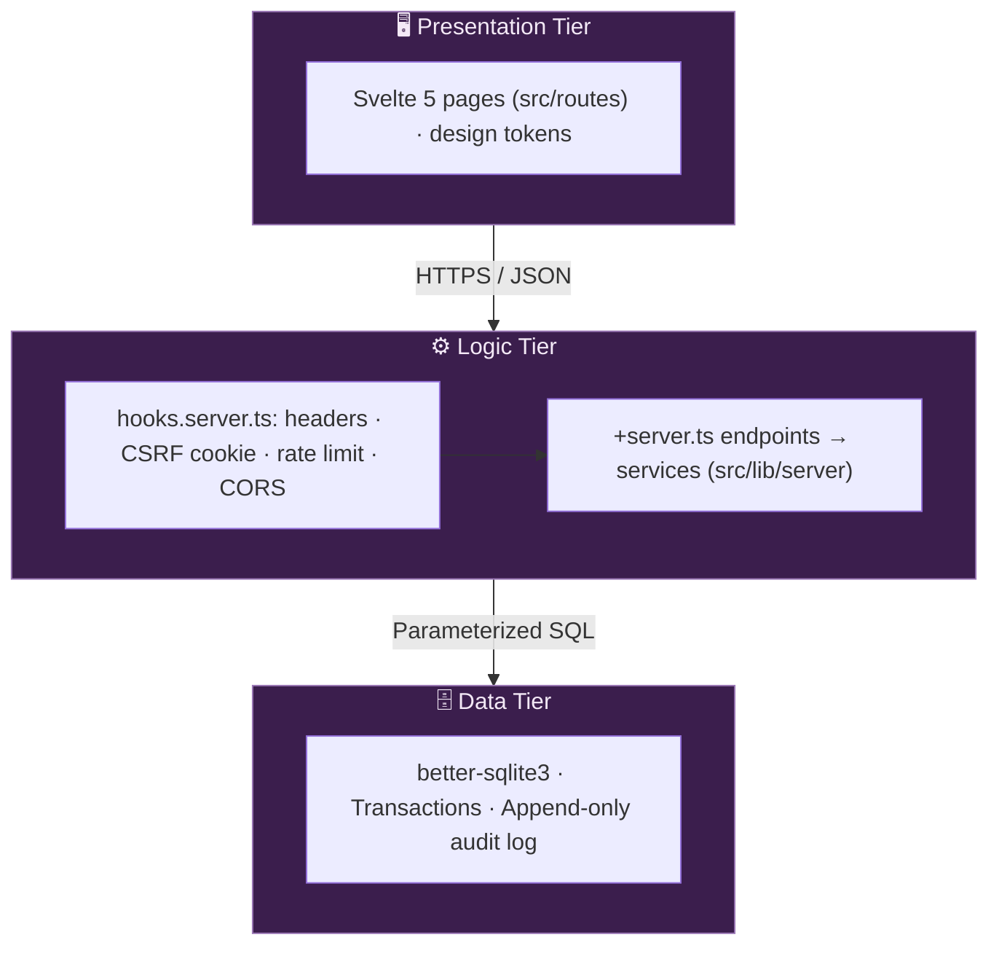
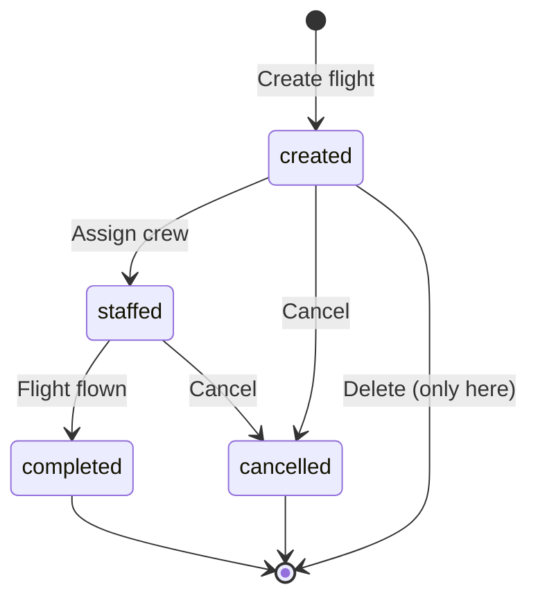
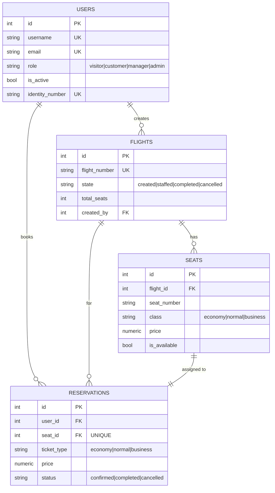

# ✈️ HorizonView

<h3 align="center">Airline Flight & Reservation Management System</h3>

<p align="center">
  <a href="https://github.com/Volanakis/HorizonView/stargazers">
    
  </a>
  <a href="https://github.com/Volanakis/HorizonView/network">
    
  </a>
  <a href="https://github.com/Volanakis/HorizonView/blob/main/LICENSE">
    
  </a>
  <a href="https://svelte.dev/docs/kit">
    
  </a>
  <a href="https://nodejs.org/">
    
  </a>
  <a href="https://www.typescriptlang.org/">
    
  </a>
  <a href="https://github.com/Volanakis/HorizonView/commits/main">
    
  </a>
  <a href="https://github.com/Volanakis/HorizonView/issues">
    
  </a>
  
</p>

---

## 📋 Table of Contents

- [🚀 About](#-about)
- [🛠️ Tech Stack](#-tech-stack)
- [🏗️ Architecture](#-architecture)
- [✨ Features](#-features)
- [📂 Project Structure](#-project-structure)
- [⚡ Quick Start](#-quick-start)
- [🧪 Demo Accounts](#-demo-accounts)
- [📦 Available Commands](#-available-commands)
- [⚙️ Configuration](#-configuration)
- [🗃️ Database Schema](#-database-schema)
- [🔌 API Endpoints](#-api-endpoints)
- [🔒 Security](#-security)
- [🚢 Deployment](#-deployment)
- [❓ Troubleshooting](#-troubleshooting)
- [📄 License](#-license)

---

## 🚀 About

HorizonView is a **full-stack web application** for airline management, featuring:

- ✈️ Flight scheduling and lifecycle management
- 🎫 Seat reservations on an interactive cabin seat map
- 👤 Role-based access control (4 user roles)
- 🔒 JWT authentication with httpOnly cookies and CSRF protection
- 🌍 External API integrations (weather, exchange rates, airport status)
- 🌐 English and Greek, light and dark themes

Built as part of the **Internet Programming** course (321-88103).

| Category | Details |
|:---------|:---------|
| **Type** | Full-stack Web Application |
| **Architecture** | 3-Tier (Presentation, Logic, Data) in one SvelteKit app |
| **Development** | Active |
| **License** | MIT |

---

## 🛠️ Tech Stack

One **SvelteKit** app serves both the UI and the JSON API — no separate backend framework.

| | Technology |
|--|--|
| Framework | SvelteKit 2 + Svelte 5 (runes) on Node.js 20.19+ (`adapter-node`) |
| API | `+server.ts` endpoints under `src/routes/api/`, services in `src/lib/server/` |
| Security | `hooks.server.ts` (headers, CSRF double-submit, rate limits, CORS) + SvelteKit's built-in nonce CSP |
| Auth | JWT (jsonwebtoken) in httpOnly cookies + bcrypt |
| Validation | Zod |
| UI | Client-rendered pages, scoped CSS on semantic purple design tokens (light + dark), English and Greek |
| Database | SQLite via better-sqlite3 (file-based, `horizonview.db`); schema in `src/lib/server/db/schema.ts` |
| Tooling | TypeScript 5 (strict), Vite 7, `svelte-check`, ESLint, Vitest + Supertest against the production build |
| Deployment | Docker (multi-stage), Docker Compose, Kubernetes (Kustomize) + Argo CD |

---

## 🏗️ Architecture

A classic **3-tier** layout inside one SvelteKit app — every request passes `hooks.server.ts` first:



More detail: [`diagrams/architecture.md`](diagrams/architecture.md), [`diagrams/api.md`](diagrams/api.md), [`diagrams/database.md`](diagrams/database.md), [`diagrams/flow.md`](diagrams/flow.md).

---

## ✨ Features

### 👤 User Management
| Feature | Description |
|---------|-------------|
| 🔐 **Authentication** | Registration and sign-in with JWT httpOnly cookies + refresh tokens; registering signs you in |
| 🔄 **Token Refresh** | Silent refresh on 401 — sessions renew without a new sign-in |
| 🛡️ **Role-Based Access** | visitor · customer · manager · admin |
| 🙍 **Profile** | Edit name, email, phone and address; change password |
| 📥 **Bulk Import** | Import up to 500 users from pasted JSON or a `.json` file (Admin) |
| 🔑 **Role Management** | Promote/demote users, activate/deactivate accounts (Admin) |
| 📋 **Audit Log** | Filterable log of sign-ins, bookings and staff actions; entries kept 90 days (Admin) |

### 🛫 Flight Management
| Feature | Description |
|---------|-------------|
| 🔄 **Lifecycle States** | created → staffed → completed / cancelled |
| ✏️ **Create & Manage** | Create flights (capacity = rows × seats per row), change state, delete |
| 🔍 **Search & Filter** | By departure, arrival and date; filters live in the URL, so searches can be shared |
| 👀 **Visibility** | Customers and guests see bookable flights; managers and admins see every state |

A flight moves through a strict state machine — only `created` flights can be deleted, and deleting one also removes its seats and bookings:



### 🎫 Reservations
| Feature | Description |
|---------|-------------|
| 🗺️ **Cabin Seat Map** | Pick a business or normal seat on a drawn cabin; economy seats are assigned automatically |
| 💺 **Ticket Classes** | Business €450 · Normal €250 · Economy €150 |
| 🧳 **Trips** | Upcoming and past bookings with booking reference, seat, class and price |
| ❌ **Cancellation** | Cancel an upcoming booking; the seat is freed immediately |

### 🌍 External Integrations
| Feature | Description |
|---------|-------------|
| 🌤️ **Weather** | Current weather at both airports on the flight page (needs `WEATHERSTACK_API_KEY`) |
| 💱 **Exchange Rates** | Show prices in EUR, USD or GBP (needs `FIXER_API_KEY`; falls back to indicative rates) |
| 🏢 **Airport Status** | Congestion check when creating a flight — Manager/Admin (needs `AVIATIONSTACK_API_KEY`) |
| 🔤 **Language Detection** | `GET /api/external/detect-language` (needs `IPSTACK_API_KEY`). The UI itself uses the browser language |

All external APIs are optional and called by the server only — the browser never contacts them.

### 🎨 Design

The UI follows two rules: **color, size and depth must carry meaning**, and **accessibility comes first**.

- **A purple palette** (`#F3E9F6` · `#CBB1D6` · `#9B78B6` · `#6C468A` · `#3B1E4D`): its lighter tints are the surfaces and its darkest shade is the text. **One flat accent** is used for the primary action, the selected seat and the current section. Other colors only mean status, and every status also has a distinct shape and a text label.
- **Airport vernacular**: airport codes, flight numbers and booking references use a monospace face, like a departures board. Two codes joined by the route line are the recurring signature. The seat map is drawn as a real cabin, with larger business seats.
- **Hierarchy over decoration**: hairline borders instead of shadows (shadows only on dialogs and toasts), radii that shrink with the element (cards 12 px, controls 8 px, chips 6 px), tabular digits for times and prices, and dates named in every list.
- **Accessible by default**: light and dark themes follow the system, every text pair is ≥ 4.5:1 and control borders ≥ 3:1, controls are 44 px on touch screens, there's full keyboard support with visible focus, native `<dialog>` confirmations put Cancel first, and errors appear next to the field that caused them.
- **Phone layout**: a bottom tab bar for navigation, a booking bar that stays reachable, and tables that turn into labelled cards.

| Token | Light | Dark | Contrast (on surface) |
|:------|:------|:-----|:----------------------|
| Background | `#f3e9f6` | `#1a0d22` | — |
| Surface | `#ffffff` | `#2a1637` | — |
| Text | `#3b1e4d` | `#f3e9f6` | 14.2 : 1 / 14.0 : 1 |
| Muted text | `#6b5a75` | `#b8a6c4` | 6.3 : 1 / 7.3 : 1 |
| Accent | `#6c468a` | `#cbb1d6` | 7.3 : 1 / 8.5 : 1 |
| Control border | `#9b78b6` | `#9b78b6` | 3.7 : 1 / 4.5 : 1 |
| Danger | `#b42318` | `#ff8a7a` | 6.6 : 1 / 7.2 : 1 |
| Success | `#17734a` | `#5fd09b` | 5.9 : 1 / 8.7 : 1 |

---

## 📂 Project Structure

```
HorizonView/
├── src/
│   ├── hooks.server.ts       # Startup (seed, cleanup), security headers, CSRF cookie, rate limit, CORS
│   ├── app.html · app.css    # Page shell; design tokens + base components
│   ├── routes/
│   │   ├── +page.svelte …    # Pages: /, /flights/[id], /trips, /manage, /users, /account,
│   │   │                     #        /login, /register, /privacy
│   │   └── api/              # JSON API — one +server.ts per endpoint
│   │       ├── auth/         # register, login, logout, refresh, me, profile, forgot/reset-password
│   │       ├── flights/      # list/create, [id], [id]/seats, [id]/state
│   │       ├── reservations/ # list/book, [id] (cancel)
│   │       ├── users/        # list, stats, audit, import, [id]/role, [id]/status (admin)
│   │       ├── external/     # weather, exchange-rates, detect-language, airport-status
│   │       ├── health/
│   │       └── [...path]/    # JSON 404 for unknown /api paths
│   └── lib/
│       ├── types.ts          # Domain types shared by UI and API
│       ├── airports.ts       # IATA → city (UI labels and weather lookups)
│       ├── api.ts            # Client fetch wrapper: CSRF header, silent token refresh
│       ├── session.svelte.ts · i18n.svelte.ts · toast.svelte.ts   # Client state (runes)
│       ├── locales/          # en.ts, el.ts
│       ├── components/       # SeatMap, RouteLine, ConfirmDialog, Pagination, …
│       └── server/           # Server-only (SvelteKit never ships it to the browser)
│           ├── http.ts       # Envelope helpers, endpoint() wrapper, body/query/id parsing
│           ├── auth.ts       # JWT, session cookies, requireUser(roles)
│           ├── csrf.ts · rate-limit.ts · schemas.ts · config.ts
│           ├── services/     # auth, flight, reservation, user, external-api
│           └── db/           # better-sqlite3 wrapper, schema, migrate and seed CLIs
├── static/                   # favicon, sw.js (removes the old service worker)
├── scripts/make-admin.mjs    # Promote/create an admin (runs locally and in Docker)
├── tests/                    # Vitest: unit tests + Supertest against build/handler.js
├── diagrams/                 # Architecture, API, database and flow docs
├── kubernetes/               # Kustomize base + staging/production overlays
├── helm/                     # Argo CD apps, Argo CD / Prometheus values, Grafana dashboard
├── Dockerfile · docker-compose.yml
├── svelte.config.js          # adapter-node + CSP
└── .env.example
```

---

## ⚡ Quick Start

### Prerequisites

| Requirement | Version |
|-------------|---------|
| Node.js | 20.19 or higher |
| npm | 9.x or higher |

### Step-by-Step

```bash
# 1. Clone the repository
git clone git@github.com:Volanakis/HorizonView.git
cd HorizonView

# 2. Install dependencies
npm install

# 3. Create environment file
cp .env.example .env
# Edit .env — set a strong JWT_SECRET (openssl rand -base64 48)

# 4. Start the dev server (UI + API, hot reload)
npm run dev
```

> 🌐 Open your browser: **http://localhost:3000**
>
> The database (`horizonview.db`) is created and seeded with the [demo accounts](#-demo-accounts) on first start.
>
> Production-style run: `npm run build && npm start`.

To run it in Docker instead, see [Docker Compose](#docker-compose).

---

## 🧪 Demo Accounts

An empty database is seeded with these accounts, plus sample flights and bookings, so you can explore every role right away:

| Role | Username | Password | Can do |
|:-----|:---------|:---------|:-------|
| 👑 **Admin** | `admin` | `Admin123!` | Everything + user/role management, audit log |
| 👑 **Admin** | `admin2` | `Admin123!` | Everything + user/role management, audit log |
| 🛫 **Manager** | `manager` | `Manager123!` | Manage flights & airport status |
| 🎫 **Customer** | `customer` | `Customer123!` | Book & cancel reservations |
| 👀 **Visitor** | `visitor` | `Visitor123!` | Browse flights & public data |

> ⚠️ **Demo credentials only** — change or remove these before any real deployment. The seed runs whenever the server starts with an empty database.

To make another admin, see [`make-admin`](#-available-commands), or use **Users → Accounts** in the app as an admin.

---

## 📦 Available Commands

| Command | Description |
|:--------|:------------|
| `npm run dev` | SvelteKit dev server (UI + API, hot reload) on port 3000 |
| `npm run build` | Production build → `build/` (adapter-node) |
| `npm start` | Run the production server (`node build`; requires build first) |
| `npm run preview` | Preview the production build with Vite |
| `npm run check` / `typecheck` | Type-check everything with `svelte-check` (pages, API, tests) |
| `npm run lint` | ESLint on `src/`, `tests/`, `scripts/` |
| `npm test` | Build, then run Vitest (integration tests hit the built server) |
| `npm run test:watch` | Vitest in watch mode (run `npm run build` first) |
| `npm run test:coverage` | Build, then run Vitest with coverage |
| `npm run migrate` | Create any missing tables, indexes and triggers (keeps existing data) |
| `npm run migrate:undo` | ⚠️ Delete the database file |
| `npm run seed` | Seed demo users, flights and bookings (skips ones that already exist) |
| `npm run seed:bulk` | Add bulk demo data (up to ~200 users and more flights) |
| `npm run seed:reservations` | Add sample bookings |
| `npm run seed:flights` | Add Greek domestic flights and seats |
| `npm run make-admin -- <user> [password]` | Promote a user to admin, or create one (Docker: `docker compose exec app npm run make-admin -- …`) |

> `make-admin` usernames are case-sensitive, and new passwords need 8+ characters with an uppercase letter, a number and a symbol. Quote the password so the shell leaves `!` alone: `npm run make-admin -- alice 'Strong123!'`.

---

## ⚙️ Configuration

The server reads these from the environment, or from `.env` in the project root:

| Variable | Default | Purpose |
|:---------|:--------|:--------|
| `JWT_SECRET` | — (**required**, ≥ 32 chars) | Signs access tokens; the server won't start without it |
| `DATABASE_URL` | `sqlite://./horizonview.db` | SQLite file (Docker: `sqlite:///app/data/horizonview.db`) |
| `NODE_ENV` | `development` | `production` makes cookies `Secure` (HTTPS only) |
| `ALLOWED_ORIGINS` | — | Comma-separated origins allowed to call the API cross-origin (not needed for the app itself) |
| `SHOW_RESET_TOKEN` | `false` | Print password-reset tokens to the server log (development only) |
| `ENABLE_EXTERNAL_VALIDATION` | `false` | Check email/phone with Mailboxlayer/Numverify at registration |
| `WEATHERSTACK_API_KEY` · `FIXER_API_KEY` · `AVIATIONSTACK_API_KEY` · `IPSTACK_API_KEY` · `MAILBOXLAYER_API_KEY` · `NUMVERIFY_API_KEY` | — | Optional external APIs; features degrade gracefully without them |

The **Node server's own settings** are read by adapter-node from the real environment only, not from `.env`:

| Variable | Default | Purpose |
|:---------|:--------|:--------|
| `PORT` · `HOST` | `3000` · `0.0.0.0` | Where `npm start` listens |
| `ORIGIN` | — | Public URL, e.g. `https://horizonview.example.com` |
| `ADDRESS_HEADER` · `XFF_DEPTH` | — | Behind a proxy: `X-Forwarded-For` and `1`, so rate limits and the audit log see real client IPs |
| `PROTOCOL_HEADER` · `HOST_HEADER` | — | Behind a proxy, as an alternative to `ORIGIN` |

To use `.env` for those as well: `node --env-file=.env build`.

---

## 🗃️ Database Schema



The schema also has `refresh_tokens`, `password_reset_tokens` and `audit_log` tables, plus housekeeping triggers — see [`diagrams/database.md`](diagrams/database.md).

<details>
<summary><b>📋 Full column definitions</b> (click to expand)</summary>

### Users Table

| Column | Type | Constraints |
|:-------|:-----|:------------|
| `id` | INTEGER | PK, AUTOINCREMENT |
| `username` | VARCHAR(50) | UNIQUE, NOT NULL |
| `password` | VARCHAR(255) | NOT NULL — bcrypt hashed |
| `name` | VARCHAR(100) | NOT NULL |
| `vat_number` | VARCHAR(20) | UNIQUE, nullable |
| `identity_number` | VARCHAR(20) | UNIQUE, NOT NULL |
| `is_active` | INTEGER | NOT NULL, DEFAULT 1 |
| `address` | TEXT | nullable |
| `employee_code` | VARCHAR(50) | UNIQUE, nullable |
| `email` | VARCHAR(100) | UNIQUE, NOT NULL |
| `phone` | VARCHAR(30) | nullable |
| `role` | VARCHAR(20) | DEFAULT `customer`, CHECK: visitor/customer/manager/admin |
| `last_login` | DATETIME | nullable |
| `created_at` / `updated_at` | DATETIME | DEFAULT CURRENT_TIMESTAMP |

### Flights Table

| Column | Type | Constraints |
|:-------|:-----|:------------|
| `id` | INTEGER | PK, AUTOINCREMENT |
| `flight_number` | VARCHAR(10) | UNIQUE, NOT NULL |
| `departure` | CHAR(3) | NOT NULL — IATA code |
| `arrival` | CHAR(3) | NOT NULL — IATA code, CHECK departure != arrival |
| `scheduled_time` | DATETIME | NOT NULL |
| `state` | VARCHAR(20) | CHECK: created/staffed/completed/cancelled |
| `total_seats` | INTEGER | NOT NULL |
| `airplane` | VARCHAR(100) | NOT NULL |
| `num_rows` / `seats_per_row` / `business_rows` | INTEGER | NOT NULL — seat-map layout |
| `created_by` | INTEGER | FK → users(id) |
| `created_at` / `updated_at` | DATETIME | DEFAULT CURRENT_TIMESTAMP |

### Seats Table

| Column | Type | Constraints |
|:-------|:-----|:------------|
| `id` | INTEGER | PK, AUTOINCREMENT |
| `flight_id` | INTEGER | FK → flights(id) ON DELETE CASCADE |
| `seat_number` | VARCHAR(5) | NOT NULL, UNIQUE(flight_id, seat_number) — e.g. "3B" |
| `class` | VARCHAR(20) | CHECK: economy/normal/business |
| `price` | NUMERIC(10,2) | NOT NULL, CHECK > 0 — in EUR |
| `is_available` | INTEGER | NOT NULL, DEFAULT 1 |

### Reservations Table

| Column | Type | Constraints |
|:-------|:-----|:------------|
| `id` | INTEGER | PK, AUTOINCREMENT |
| `user_id` | INTEGER | FK → users(id) |
| `flight_id` | INTEGER | FK → flights(id) |
| `seat_id` | INTEGER | FK → seats(id), UNIQUE |
| `ticket_type` | VARCHAR(20) | CHECK: economy/normal/business |
| `price` | NUMERIC(10,2) | NOT NULL — snapshot at booking |
| `status` | VARCHAR(20) | CHECK: confirmed/completed/cancelled |
| `cancelled_at` | DATETIME | nullable |
| `created_at` / `updated_at` | DATETIME | DEFAULT CURRENT_TIMESTAMP |

</details>

---

## 🔌 API Endpoints

All `/api` responses use `{ success, data?, error?, pagination? }` envelopes (except `/api/health`), and unknown `/api` paths return a JSON 404. **Auth** means a valid `access_token` cookie; **CSRF** means the `X-CSRF-Token` header must match the `csrf_token` cookie.

### System

| Method | Endpoint | Access | Description |
|:-------|:---------|:-------|:------------|
| `GET` | `/api/health` | Public | Returns `{ status, database }` — 503 if DB unreachable |

### Authentication

| Method | Endpoint | Access | Description |
|:-------|:---------|:-------|:------------|
| `POST` | `/api/auth/register` | Public | Register new account |
| `POST` | `/api/auth/login` | Public | Sign in; sets session cookies (no token in the body) |
| `POST` | `/api/auth/logout` | Auth + CSRF | Sign out; revokes the user's refresh tokens |
| `POST` | `/api/auth/refresh` | CSRF | Rotate refresh token |
| `GET` | `/api/auth/me` | Auth | Get current user |
| `PATCH` | `/api/auth/profile` | Auth + CSRF | Update profile (name, email, address, phone) or password (`currentPassword`, `newPassword`) |
| `POST` | `/api/auth/forgot-password` | Public | Request password reset; same answer whether or not the email exists |
| `POST` | `/api/auth/reset-password` | Public | Reset password with token |

### Flights

| Method | Endpoint | Access | Description |
|:-------|:---------|:-------|:------------|
| `GET` | `/api/flights` | Public | List flights (`from`, `to`, `date`, `page`, `limit`); managers/admins also get completed and cancelled flights |
| `GET` | `/api/flights/:id` | Public | Get flight details |
| `GET` | `/api/flights/:id/seats` | Public | Seat map (`class` filter optional); availability only, never who booked |
| `POST` | `/api/flights` | Manager/Admin + CSRF | Create flight |
| `PATCH` | `/api/flights/:id/state` | Manager/Admin + CSRF | Advance flight state |
| `DELETE` | `/api/flights/:id` | Manager/Admin + CSRF | Delete flight (only `created` state) with its seats and bookings |

### Reservations

| Method | Endpoint | Access | Description |
|:-------|:---------|:-------|:------------|
| `GET` | `/api/reservations` | Customer/Manager/Admin | Current user's reservations (`page`, `limit`) |
| `POST` | `/api/reservations` | Customer/Manager/Admin + CSRF | Book `{ flight_id, ticket_type, seat_number? }` in an atomic transaction; economy needs no seat number |
| `DELETE` | `/api/reservations/:id` | Customer/Manager/Admin + CSRF | Cancel own reservation, frees the seat |

### Users (Admin Only)

| Method | Endpoint | Access | Description |
|:-------|:---------|:-------|:------------|
| `GET` | `/api/users` | Admin | List users (`role`, `search`, `page`, `limit`) |
| `GET` | `/api/users/stats` | Admin | User counts by role |
| `GET` | `/api/users/audit` | Admin | Audit log (`action`, `page`, `limit`) |
| `PATCH` | `/api/users/:id/role` | Admin + CSRF | Change user role (not your own) |
| `PATCH` | `/api/users/:id/status` | Admin + CSRF | Activate/deactivate user |
| `POST` | `/api/users/import` | Admin + CSRF | Bulk import users via JSON (1–500); existing ones are skipped |

### External Integrations

All rate-limited to 10 requests/min per IP.

| Method | Endpoint | Access | Description |
|:-------|:---------|:-------|:------------|
| `GET` | `/api/external/weather` | Public | Current weather (`location`: city or IATA code) |
| `GET` | `/api/external/exchange-rates` | Public | EUR-based rates (`base`, `symbols`, default `USD,GBP`) |
| `GET` | `/api/external/detect-language` | Public | Country/language from the caller's IP |
| `GET` | `/api/external/airport-status` | Manager/Admin | Airport congestion (`iata`, `datetime`) |

Request and response examples: [`diagrams/api.md`](diagrams/api.md).

---

## 🔒 Security

| Protection | Implementation |
|------------|----------------|
| 🍪 **Auth cookies** | JWT in `httpOnly` + `SameSite=Strict` cookies, `Secure` when `NODE_ENV=production`; access token 15 min, refresh token 7 days |
| 🔄 **Token rotation** | Refresh tokens rotated on every `/auth/refresh` call; reuse of a revoked token revokes all user tokens |
| 🛡️ **CSRF** | Double-submit cookie — `X-CSRF-Token` header required on all mutations; token rotated at sign-in |
| 🔑 **Password hashing** | bcrypt, 12 salt rounds |
| ✅ **Input validation** | Zod schemas on all request bodies, query params, and `:id` params; 100 KB body limit |
| 🚦 **Rate limiting** | Login: 5/15 min (per IP + username) · Register: 3/hr · Refresh: 10/15 min · Forgot password: 3/hr · Reset password: 5/15 min · External API: 10/min · Other API: 100/15 min (static assets are not limited) |
| 🏗️ **Security headers** | Pages: SvelteKit CSP with a per-request nonce (`script-src 'self'`, no `unsafe-eval`/`unsafe-inline`, `connect-src 'self'`, `frame-ancestors 'none'`). API: `default-src 'none'` + `Cache-Control: no-store`. All: HSTS, nosniff, `X-Frame-Options: DENY`, COOP/CORP (`hooks.server.ts`) |
| 💉 **SQL injection** | Parameterized queries only — no string concatenation |
| 🔍 **IDOR prevention** | Ownership verified in the service layer with the session's user id, never from the client payload |
| 🔌 **Account deactivation** | Deactivated users are rejected on every authenticated request |
| 📋 **Audit log** | Append-only table of auth, flight, reservation and admin events; entries older than 90 days are purged |
| 🔐 **Privacy** | Privacy notice at `/privacy`; language comes from the browser, not an IP lookup; external APIs are never called from the browser |
| 🔗 **Behind a proxy** | Set adapter-node's `ADDRESS_HEADER=X-Forwarded-For`, `XFF_DEPTH=1` (real client IP for rate limits and the audit log) and `PROTOCOL_HEADER`/`HOST_HEADER` or `ORIGIN` |

---

## 🚢 Deployment

### Docker Compose

```bash
docker compose up -d --build      # build and start on http://localhost:3000
docker compose logs -f app        # follow the logs
docker compose exec app npm run make-admin -- <user> [password]
docker compose down               # stop (the data volume is kept; add -v only to delete the database)
```

- Compose reads `JWT_SECRET`, `NODE_ENV`, `ALLOWED_ORIGINS`, `SHOW_RESET_TOKEN` and `PORT` (host port) from `.env`. **Set `JWT_SECRET`** — the compose file's fallback secret is public.
- The database lives in the `horizonview-data` volume at `/app/data/horizonview.db`.
- The container reports `healthy` once `GET /api/health` answers.

### Kubernetes

Kustomize manifests live in `kubernetes/`: a `base` plus `staging` and `production` overlays (namespaces `horizonview-staging` / `horizonview-prod`, image `ghcr.io/volanakis/horizonview`).

```bash
kubectl apply -k kubernetes/overlays/staging
```

- Create the `horizonview-secret` Secret with `JWT_SECRET` (and any API keys) yourself, or via SealedSecrets/External Secrets. **Don't apply the placeholder `secrets.yaml` as-is.**
- The ConfigMap already sets the proxy headers for the ingress (`ADDRESS_HEADER`, `XFF_DEPTH`, `PROTOCOL_HEADER`, `HOST_HEADER`).
- Argo CD applications for both environments are in `helm/argocd-apps/`.

### Render

**Build command:** `npm ci --include=dev && npm run build` (the SvelteKit toolchain is a dev dependency)  
**Start command:** `npm start`

**Required environment variables:**

```
NODE_ENV=production
DATABASE_URL=sqlite://./horizonview.db
JWT_SECRET=<generate a strong random string>
ORIGIN=https://your-app.onrender.com
ADDRESS_HEADER=X-Forwarded-For
XFF_DEPTH=1
```

> **Note — SQLite on Render:** Render's filesystem is ephemeral. The `horizonview.db` file is wiped on every deploy or restart. The app auto-seeds demo data on an empty database, but all user accounts and reservations are lost. For persistent storage, use a persistent disk or switch to PostgreSQL.

**Post-deploy checklist:**

- [ ] Set `JWT_SECRET` to a strong random value
- [ ] Change or remove the demo accounts
- [ ] Verify `GET /api/health` returns `{ "status": "ok", "database": "connected" }`
- [ ] Test the sign-in flow (CSRF cookie + header working)
- [ ] Test a deep link (e.g., visit `/trips` directly — every page route is served by SvelteKit)

---

## ❓ Troubleshooting

| Issue | Cause | Solution |
|:------|:------|:---------|
| `EADDRINUSE: Port 3000` | Port already in use (often a running HorizonView container) | `PORT=3001 npm start`, or stop the other process — `npm run dev` picks the next free port itself |
| `PORT` in `.env` is ignored by `npm start` | adapter-node reads only the real environment | `PORT=3001 npm start` or `node --env-file=.env build` |
| `JWT_SECRET must be at least 32 characters` on start | Missing/short secret | Copy `.env.example` to `.env` and set `JWT_SECRET` (`openssl rand -base64 48`) |
| `Cannot connect to the Docker daemon` | Docker CLI points at an engine that isn't running (e.g. Docker Desktop) | `docker context ls`, then `docker context use default` (or start Docker Desktop) |
| `ports are not available … 3000` in Docker | Another engine or container already uses port 3000 | Stop the other container, or set `PORT=3001` in `.env` for compose |
| `service "npm" is not running` | Missing service name in `docker compose exec` | `docker compose exec app npm run …` |
| `Cannot find module 'build/handler.js'` in tests | No build yet | Run `npm test` (it builds first), not `vitest` alone |
| 403 on mutations | Missing CSRF token | Send the `csrf_token` cookie value in the `X-CSRF-Token` header |
| Token expired | 401 returned | The UI auto-retries via `/auth/refresh` — check the refresh token cookie |
| Data wiped on Render | Ephemeral filesystem | Expected for demo; use a persistent disk or PostgreSQL |

---

## 📄 License

Released under the **MIT License** — Copyright (c) 2026 Volanakis Dimitrios.

---

<p align="center">
  <sub>Built with ✈️ for the <b>Internet Programming</b> course (321-88103)</sub>
  <br><br>
  ⭐ <b>If you find this project useful, consider giving it a star!</b> ⭐
  <br><br>
  <a href="#-horizonview">⬆️ Back to top</a>
</p>
