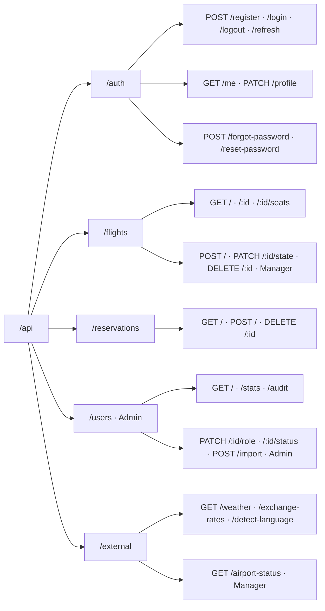

# 🔌 API Endpoints

> All responses use a `{ success, data?, error?, pagination? }` envelope.

## REST API Structure



## Authentication Endpoints

| Endpoint | Rate | Request | Success | Failure |
|:---------|:-----|:--------|:--------|:--------|
| `POST /auth/login` | 5 / 15m | `{ username, password }` | `200` — sets `access_token` + `refresh_token` httpOnly cookies; body `{ user }`; **no token in body** | `401` generic "Invalid credentials" |
| `POST /auth/register` | 3 / hr | `{ username, password, name, email, identity_number, vat_number?, address?, phone?, employee_code? }` | `201` — `{ user }` | `422` field-level errors |
| `POST /auth/refresh` | 10 / 15m | `refresh_token` cookie + `X-CSRF-Token` | `200` — rotates both cookies (old token revoked) | `401` invalid/expired/reused |
| `POST /auth/logout` | — | `refresh_token` cookie + `X-CSRF-Token` | `204` — revokes token, clears cookies | — |
| `GET /auth/me` | — | `access_token` cookie | `{ id, username, name, email, role }` | `401` if no valid token |
| `PATCH /auth/profile` | — | Auth + CSRF — `{ name?, email?, address?, phone? }` | `200` — updated user | `422` field-level errors |
| `POST /auth/forgot-password` | 3 / hr | `{ email }` | `200` — token sent (dev: included in body if `SHOW_RESET_TOKEN`) | `404` email not found |
| `POST /auth/reset-password` | 5 / 15m | `{ token, password }` | `200` — password updated, all refresh tokens revoked | `401` invalid/expired token |

> **Password policy (Zod):** min 8 chars, ≥1 uppercase, ≥1 number, ≥1 symbol. `vat_number`, `address`, `phone`, `employee_code` are optional on register.

### Rate Limiting Summary

| Limiter | Endpoint | Limit | Window |
|:--------|:---------|:-----|:-------|
| `loginLimiter` | POST /auth/login | 5 | 15 min |
| `registerLimiter` | POST /auth/register | 3 | 1 hour |
| `refreshLimiter` | POST /auth/refresh | 10 | 15 min |
| `forgotPasswordLimiter` | POST /auth/forgot-password | 3 | 1 hour |
| `resetPasswordLimiter` | POST /auth/reset-password | 5 | 15 min |
| `externalApiLimiter` | GET /external/* | 10 | 1 min |
| `apiLimiter` | All other endpoints | 100 | 15 min |

## Flights Endpoints

| Endpoint | Access | Notes |
|:---------|:-------|:------|
| `GET /flights` | Public | Query `?from=ATH&to=LHR&date=2025-06-01&page=1&limit=20` — all params validated; paginated |
| `GET /flights/:id/seats` | Public | `{ seats: [{ number, class, status }] }` — `available` / `reserved`, no `user_id` exposed |
| `POST /flights` | Manager/Admin + CSRF | Body `{ flight_number, departure, arrival, scheduled_time, total_seats, ... }`; Zod validates IATA codes & future datetime → `201` |
| `PATCH /flights/:id/state` | Manager/Admin + CSRF | `{ state: "staffed" \| "completed" \| "cancelled" }`; state machine enforced server-side; invalid → `422` |
| `DELETE /flights/:id` | Manager/Admin + CSRF | Allowed only in `created` state |

## Reservations Endpoints

| Endpoint | Access | Notes |
|:---------|:-------|:------|
| `GET /reservations` | Auth | Current user's reservations only |
| `POST /reservations` | Auth + CSRF | Body `{ flight_id, ticket_type, seat_number? }`; booked inside a **`better-sqlite3` transaction** that re-checks availability (prevents double-booking) → `201`, or `409` if the seat is taken |
| `DELETE /reservations/:id` | Auth + CSRF | Ownership verified via `req.user.userId` (IDOR prevention); soft-cancels (`status → 'cancelled'`) and frees the seat → `204` |

## Users Endpoints (Admin Only)

| Endpoint | Access | Notes |
|:---------|:-------|:------|
| `GET /users` | Admin | `?role=admin&search=john&page=1&limit=20` — role-filtered, searchable, paginated |
| `GET /users/stats` | Admin | Returns `{ total, roles: { admin, manager, customer, visitor } }` |
| `GET /users/audit` | Admin | `?user_id=1&action=LOGIN&page=1&limit=20` — filtered, paginated audit log |
| `PATCH /users/:id/role` | Admin + CSRF | `{ role: "manager" }` — promote/demote user |
| `PATCH /users/:id/status` | Admin + CSRF | `{ is_active: false }` — activate/deactivate user (cannot deactivate self) |
| `POST /users/import` | Admin + CSRF | `{ users: [ { username, password, name, email, identity_number, role?, vat_number?, address?, employee_code? } ] }` — max 500 per batch; returns `{ imported, skipped, errors[] }` |

## External Endpoints

| Endpoint | Access | Notes |
|:---------|:-------|:------|
| `GET /external/weather` | Public | Rate-limited: 10/min |
| `GET /external/exchange-rates` | Public | Rate-limited: 10/min |
| `GET /external/detect-language` | Public | Rate-limited: 10/min |
| `GET /external/airport-status` | Manager/Admin | Rate-limited: 10/min |

## Standard Response Envelopes

**Success**
```json
{ "success": true, "data": { } }
```

**Error** — no stack traces, internal paths, or DB errors leak
```json
{ "success": false, "error": { "code": "VALIDATION_ERROR", "message": "Invalid email format" } }
```

**Paginated**
```json
{
  "success": true,
  "data": [],
  "pagination": { "page": 1, "limit": 20, "total": 100, "pages": 5 }
}
```

## HTTP Status Codes

| Code | Meaning |
|:-----|:--------|
| `200` | OK |
| `201` | Created |
| `204` | No content (deletion / logout) |
| `400` | Bad request (malformed) |
| `401` | Unauthorized (missing/invalid token) |
| `403` | Forbidden (valid token, insufficient role) |
| `404` | Not found |
| `409` | Conflict (seat taken, duplicate username/email) |
| `422` | Validation failed (Zod field errors) |
| `429` | Too many requests (`Retry-After` set) |
| `500` | Server error (generic message, logged server-side) |

## Security Checklist per Endpoint Group

| Concern | Auth | Flights | Reservations | Users | External |
|:--------|:----:|:-------:|:------------:|:-----:|:--------:|
| Rate limiting | ✅ | ✅ | ✅ | ✅ | ✅ |
| Zod input validation | ✅ | ✅ | ✅ | ✅ | — |
| CSRF token (mutations) | ✅ | ✅ | ✅ | ✅ | — |
| Role check (`requireUser`) | — | ✅ | ✅ | ✅ | ✅ |
| Ownership check (IDOR) | — | — | ✅ | — | — |
| DB transaction | — | — | ✅ | ✅ | — |
| Audit-log entry | ✅ | ✅ | ✅ | ✅ | — |
| Password reset flow | ✅ | — | — | — | — |
| Account deactivation check | ✅ | — | — | ✅ | — |
