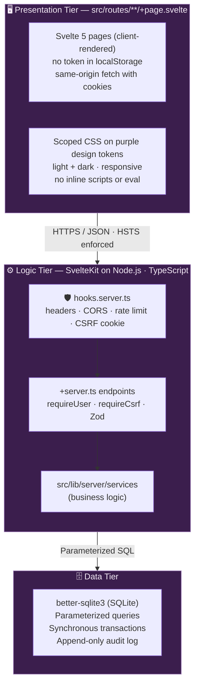
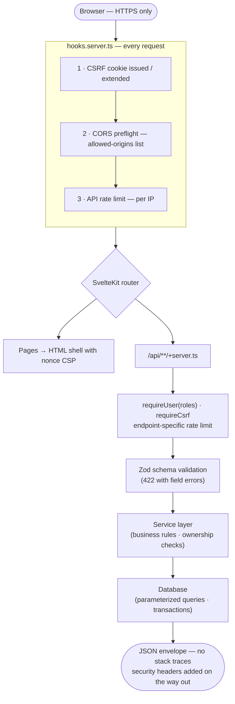

# 🏗️ System Architecture

> Diagrams render natively on GitHub via [Mermaid](https://mermaid.js.org/).

## 3-Tier Architecture (Security-Hardened)

One SvelteKit app (adapter-node) holds all three tiers: Svelte pages, `+server.ts` API endpoints, and server-only services.

## Request Flow (with Security Layers)

## Security Details

### 🪖 Response Headers

| Header | Value |
|:-------|:------|
| `Content-Security-Policy` (pages) | Set by SvelteKit (`kit.csp`): `script-src 'self' 'nonce-…'` · `style-src 'self'` · `connect-src 'self'` · `frame-ancestors 'none'` |
| `Content-Security-Policy` (API) | `default-src 'none'; frame-ancestors 'none'` + `Cache-Control: no-store` |
| `Strict-Transport-Security` | `max-age=31536000; includeSubDomains` |
| `X-Frame-Options` | `DENY` |
| `X-Content-Type-Options` | `nosniff` |
| `Referrer-Policy` | `strict-origin-when-cross-origin` |
| `Cross-Origin-Opener-Policy` / `-Resource-Policy` | `same-origin` |

### 🚦 Rate Limiting

| Endpoint | Limit |
|:---------|:------|
| `POST /api/auth/login` | 5 requests / 15 min |
| `POST /api/auth/register` | 3 requests / hour |
| `POST /api/auth/refresh` | 10 requests / 15 min |
| `POST /api/auth/forgot-password` | 3 requests / hour |
| `POST /api/auth/reset-password` | 5 requests / 15 min |
| `GET /api/external/*` | 10 requests / min |
| All other `/api` endpoints | 100 requests / 15 min (static assets are not limited) |

### 🔑 Authentication

| Token | Details |
|:------|:--------|
| **Access token** | JWT · 15 min TTL · `httpOnly + Secure` cookie |
| **Refresh token** | Opaque · 7 day TTL · stored hashed · single-use rotation |
| **CSRF token** | Double-submit cookie pattern, required on all mutations |

### ✅ Input Validation

- All request bodies, query params, and `:id` params validated with **Zod** schemas.
- Bulk user import validated per-row (JSON payload, max 500 users).

## Technology Stack

```mermaid
flowchart LR
    subgraph FE["Frontend"]
        SV["Svelte 5 pages"]
        CSS["Scoped CSS + purple tokens"]
        FX["fetch + CSRF header"]
    end
    subgraph BE["Backend"]
        N["Node.js 20.19+"]
        KIT["SvelteKit 2 · adapter-node"]
        TS["TypeScript 5.x"]
        SECX["hooks.server.ts · zod · jsonwebtoken"]
    end
    subgraph DB["Database"]
        SQ["SQLite (better-sqlite3)"]
        TX["Synchronous transactions"]
        CK["CHECK constraints (enum-like)"]
        AUD["Append-only audit log"]
    end
    FE --> BE --> DB
```

**Database notes**

- Parameterized queries only — no string concatenation.
- Concurrency: SQLite serializes writes; seat booking re-checks availability inside a synchronous transaction (see [`database.md`](./database.md)).
- `CHECK` constraints emulate enums on `role`, `state`, `class`, `status`.
