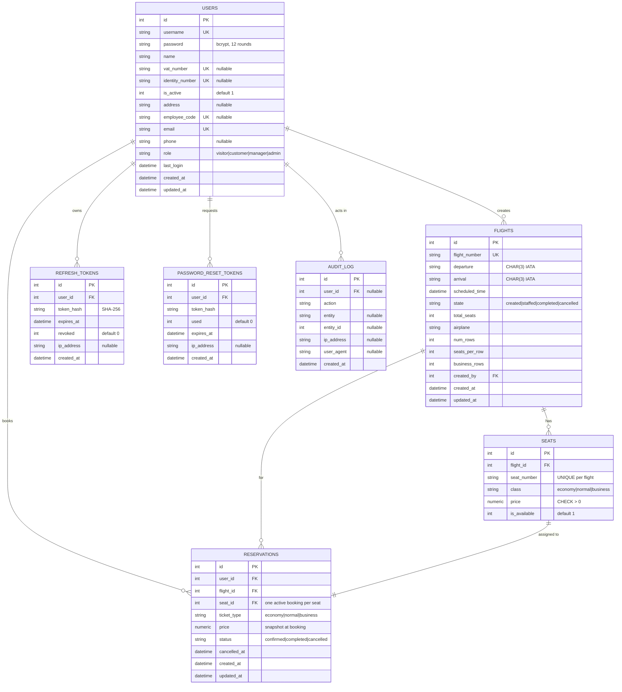
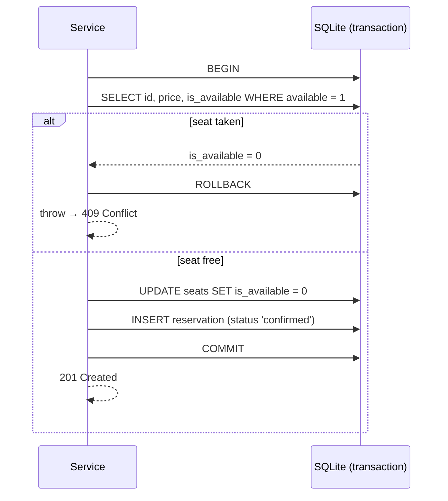

# 🗃️ Database Schema

> SQLite via **better-sqlite3** — file-based (`horizonview.db`). Schema lives in [`src/lib/server/db/schema.ts`](../src/lib/server/db/schema.ts) (single source of truth).

## Entity Relationship Diagram

## Table Details

### Users

| Column | Type | Constraints |
|:-------|:-----|:------------|
| `id` | INTEGER | PK, AUTOINCREMENT |
| `username` | VARCHAR(50) | UNIQUE, NOT NULL |
| `password` | VARCHAR(255) | NOT NULL — bcrypt, 12 rounds |
| `name` | VARCHAR(100) | NOT NULL |
| `vat_number` | VARCHAR(20) | UNIQUE, nullable |
| `identity_number` | VARCHAR(20) | UNIQUE, nullable — optional at sign-up |
| `is_active` | INTEGER | NOT NULL, DEFAULT 1 |
| `address` | TEXT | nullable |
| `employee_code` | VARCHAR(50) | UNIQUE, nullable |
| `email` | VARCHAR(100) | UNIQUE, NOT NULL |
| `phone` | VARCHAR(30) | nullable |
| `role` | VARCHAR(20) | NOT NULL, DEFAULT `'customer'`, CHECK `visitor/customer/manager/admin` |
| `last_login` | DATETIME | nullable |
| `created_at` / `updated_at` | DATETIME | DEFAULT CURRENT_TIMESTAMP |

> `VARCHAR + CHECK` is used instead of a native ENUM so roles can evolve without a migration. Datetimes are stored as ISO-8601 text (UTC).

### Flights

| Column | Type | Constraints |
|:-------|:-----|:------------|
| `id` | INTEGER | PK, AUTOINCREMENT |
| `flight_number` | VARCHAR(10) | UNIQUE, NOT NULL |
| `departure` | CHAR(3) | NOT NULL — IATA code |
| `arrival` | CHAR(3) | NOT NULL — IATA code, CHECK `departure != arrival` |
| `scheduled_time` | DATETIME | NOT NULL |
| `state` | VARCHAR(20) | NOT NULL, DEFAULT `'created'`, CHECK `created/staffed/completed/cancelled` |
| `total_seats` | INTEGER | NOT NULL |
| `airplane` | VARCHAR(100) | NOT NULL |
| `num_rows` / `seats_per_row` / `business_rows` | INTEGER | NOT NULL — seat-map layout |
| `created_by` | INTEGER | FK → users(id) |

### Seats

| Column | Type | Constraints |
|:-------|:-----|:------------|
| `id` | INTEGER | PK, AUTOINCREMENT |
| `flight_id` | INTEGER | FK → flights(id) ON DELETE CASCADE |
| `seat_number` | VARCHAR(5) | NOT NULL |
| `class` | VARCHAR(20) | CHECK `economy/normal/business` |
| `price` | NUMERIC(10,2) | NOT NULL, CHECK > 0 |
| `is_available` | INTEGER | NOT NULL, DEFAULT 1 |

`UNIQUE (flight_id, seat_number)`

> **Why a separate seats table:** per-seat pricing, and a single availability flag that can be flipped atomically inside a transaction to prevent double-booking.

### Reservations

| Column | Type | Constraints |
|:-------|:-----|:------------|
| `id` | INTEGER | PK, AUTOINCREMENT |
| `user_id` | INTEGER | FK → users(id) |
| `flight_id` | INTEGER | FK → flights(id) |
| `seat_id` | INTEGER | FK → seats(id); one non-cancelled booking per seat (partial unique index) |
| `ticket_type` | VARCHAR(20) | CHECK `economy/normal/business` |
| `price` | NUMERIC(10,2) | NOT NULL — snapshot at booking |
| `status` | VARCHAR(20) | DEFAULT `'confirmed'`, CHECK `confirmed/completed/cancelled` |
| `cancelled_at` | DATETIME | nullable |
| `created_at` / `updated_at` | DATETIME | DEFAULT CURRENT_TIMESTAMP |

### Refresh Tokens

| Column | Type | Constraints |
|:-------|:-----|:------------|
| `id` | INTEGER | PK, AUTOINCREMENT |
| `user_id` | INTEGER | FK → users(id) ON DELETE CASCADE |
| `token_hash` | VARCHAR(255) | NOT NULL — SHA-256 of the raw token |
| `expires_at` | DATETIME | NOT NULL |
| `revoked` | INTEGER | NOT NULL, DEFAULT 0 |
| `ip_address` | TEXT | nullable |

> Raw tokens are **never** stored. Revoked rows are kept until `expires_at` to detect reuse (reuse → revoke all the user's tokens).

### Password Reset Tokens

| Column | Type | Constraints |
|:-------|:-----|:------------|
| `id` | INTEGER | PK, AUTOINCREMENT |
| `user_id` | INTEGER | FK → users(id) ON DELETE CASCADE |
| `token_hash` | VARCHAR(255) | NOT NULL — SHA-256 of the raw token |
| `used` | INTEGER | NOT NULL, DEFAULT 0 |
| `expires_at` | DATETIME | NOT NULL — 1 hour TTL |
| `ip_address` | TEXT | nullable |

> Same design as refresh tokens: raw token is never stored, SHA-256 hash only. Tokens have a 1-hour expiry and are marked as `used` on successful reset.

### Audit Log

| Column | Type | Constraints |
|:-------|:-----|:------------|
| `id` | INTEGER | PK, AUTOINCREMENT |
| `user_id` | INTEGER | FK → users(id), nullable (pre-auth events) |
| `action` | VARCHAR(100) | NOT NULL — e.g. `LOGIN_FAILED` |
| `entity` | VARCHAR(50) | nullable — e.g. `reservation` |
| `entity_id` | INTEGER | nullable |
| `ip_address` | TEXT | nullable |
| `user_agent` | TEXT | nullable |
| `created_at` | DATETIME | DEFAULT CURRENT_TIMESTAMP |

> Append-only by convention. Logged events: `REGISTER`, `LOGIN`, `LOGIN_FAILED`, `LOGOUT`, `REFRESH`, `PROFILE_UPDATE`, `FORGOT_PASSWORD`, `PASSWORD_RESET`, `FLIGHT_CREATE`, `FLIGHT_STATE_CHANGE`, `FLIGHT_DELETE`, `RESERVATION_CREATE`, `RESERVATION_CANCEL`, `USER_ROLE_CHANGE`, `USER_STATUS_CHANGE`, `USER_IMPORT`.

## Indexes

| Table | Indexed columns | Purpose |
|:------|:----------------|:--------|
| `users` | `username`, `email`, `role` | login lookup, role filtering |
| `flights` | `flight_number`, `state`, `scheduled_time` | search & date-range filtering |
| `seats` | `flight_id`; `(flight_id, seat_number)` UNIQUE | seat-map queries |
| `reservations` | `user_id`, `flight_id`; `seat_id` UNIQUE `WHERE status <> 'cancelled'` | user list, manifest, one active booking per seat (cancelled seats can be re-booked) |
| `refresh_tokens` | `user_id`, `token_hash` | refresh lookup, revoke-all |
| `password_reset_tokens` | `token_hash` | reset lookup |
| `audit_log` | `user_id` | per-user history and action-based queries |

## Housekeeping and migrations

There are no triggers. Housekeeping runs when the server starts (`hooks.server.ts`):

| Step | Action |
|:-----|:-------|
| Token cleanup | Deletes expired or revoked refresh tokens and used or expired password-reset tokens |
| Audit retention | Deletes audit log entries older than 90 days |
| Demo data | Seeds demo accounts, flights and bookings into an empty database (not in production unless `SEED_DEMO_DATA=true`) |

`src/lib/server/db/migrations.ts` upgrades databases created by older versions when they are opened: it rebuilds `reservations` (old table-level `UNIQUE(seat_id)`, which kept cancelled seats blocked) and `users` (old `identity_number NOT NULL`). Each step checks the stored schema first, so it only ever runs once.

## Concurrency: Seat Booking Transaction

SQLite serializes write transactions, so there is no `SELECT ... FOR UPDATE`. The service wraps the read-check-write in a **synchronous `better-sqlite3` transaction** and re-checks availability before flipping the flag — the partial unique index on `reservations(seat_id)` (non-cancelled bookings only) is the final backstop.

