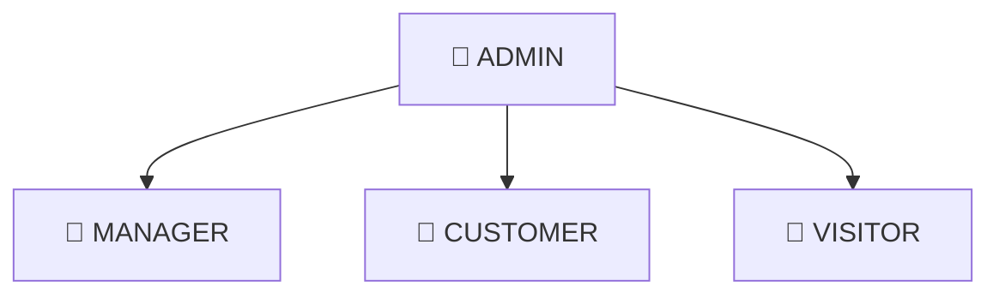
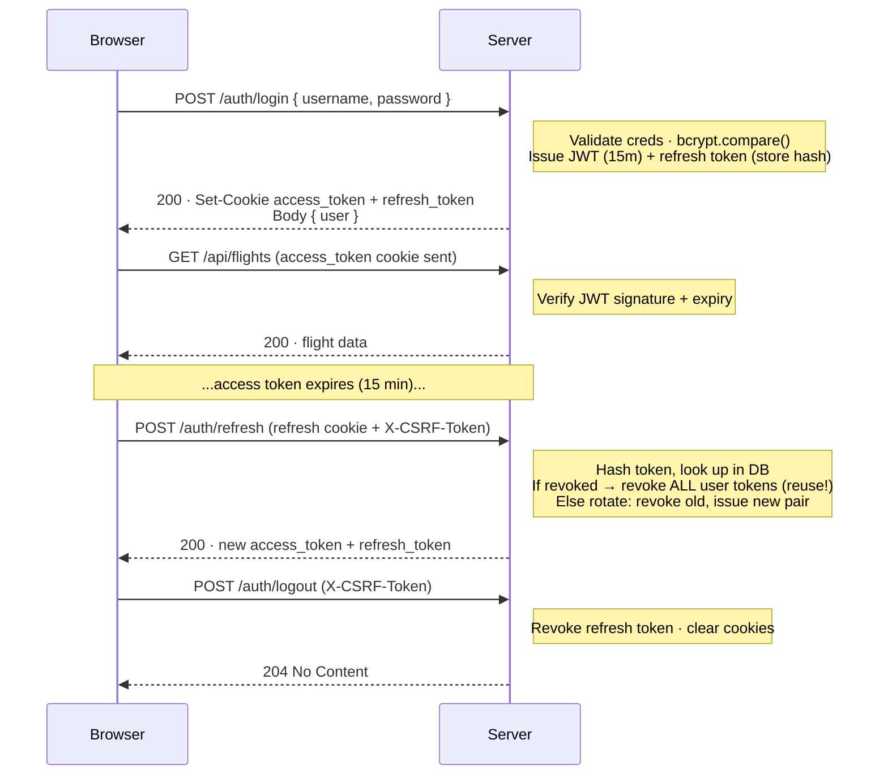
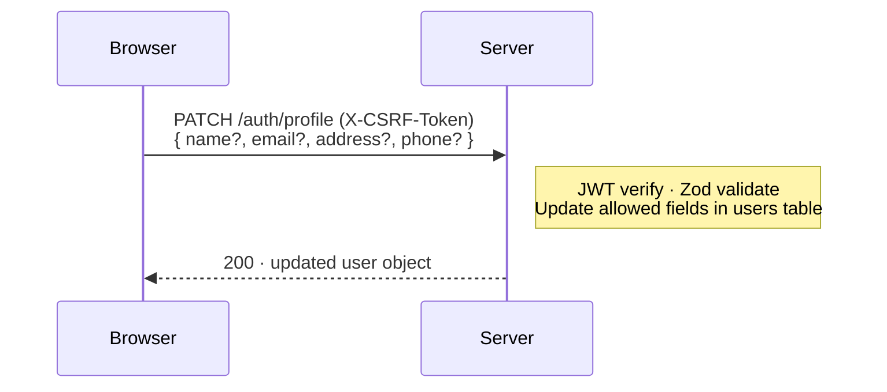
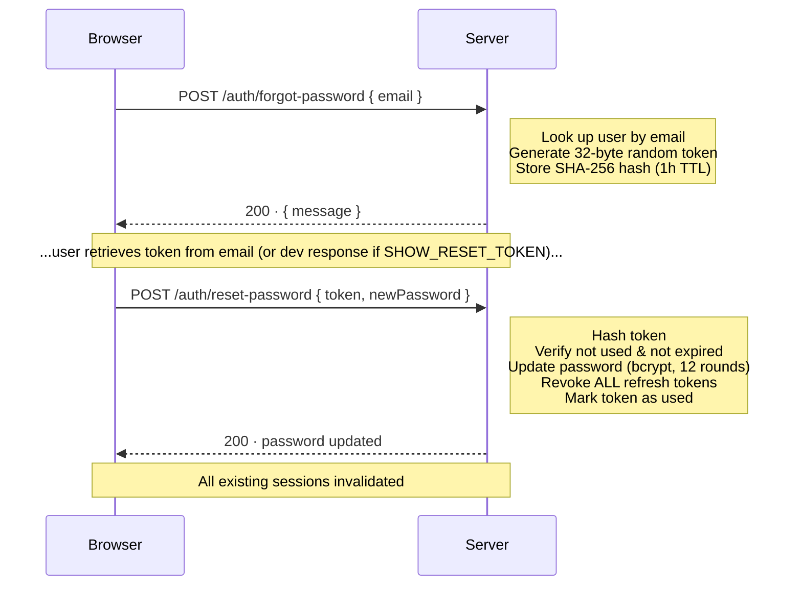
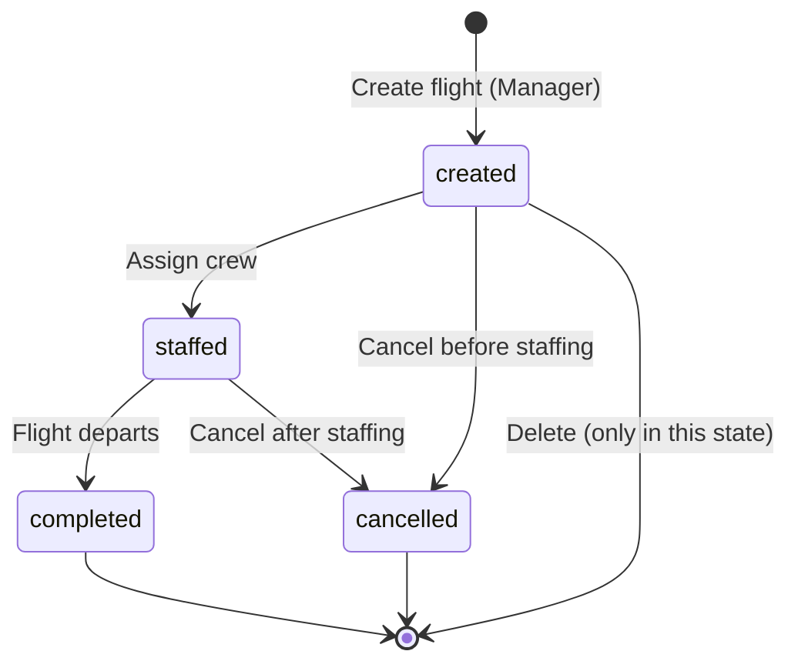
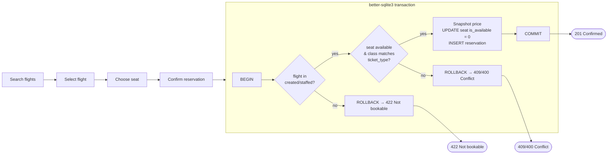
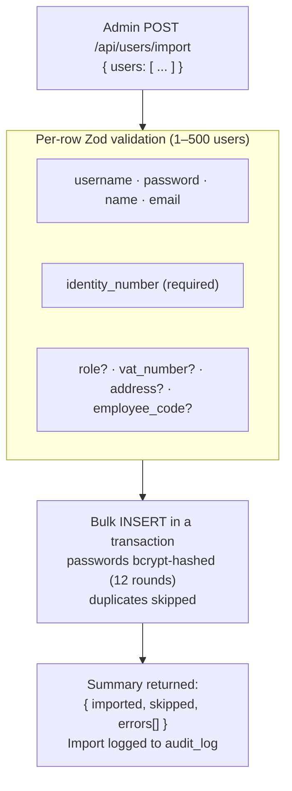

# 👥 User Roles & Workflows

> Diagrams render natively on GitHub via [Mermaid](https://mermaid.js.org/).

## User Roles

### Role Permissions

| Role | Permissions |
|:-----|:------------|
| 👑 **Admin** | All manager permissions · user management (view, stats, role change, toggle active) · **bulk import users (JSON)** · audit-log access |
| 🛫 **Manager** | Flight CRUD (delete only in `created` state) · flight state transitions · airport-status lookup |
| 🎫 **Customer** | Search/view flights · make reservations (own — IDOR enforced) · view/cancel own reservations · update own profile |
| 👀 **Visitor** | Search/view flights (public data) · register · login · forgot/reset password · external APIs (weather, exchange rates, language detection) |

## Authentication Flow (httpOnly Cookie + Refresh Token Rotation)

## Profile Update Flow

## Password Reset Flow

## Flight Lifecycle (State Machine)

| State | Rules |
|:------|:------|
| `created` | Seats bookable · flight deletable (only if no confirmed reservations) |
| `staffed` | Pricing locked (snapshot in seats) · seats locked |
| `completed` | Terminal — no mutations (write attempt → 422) |
| `cancelled` | Terminal — reservations auto-cancelled |

> Transitions are enforced in the **service layer** (not just the DB `CHECK`). Invalid transitions return `422`; every transition is written to the audit log.

## Booking Flow (with Concurrency Safety)

### Ticket Classes

| Class | Cabin rows | Tier |
|:------|:-----------|:-----|
| 💺 **Business** | Front rows | Highest price · premium service |
| 🪑 **Normal** | Middle rows | Mid price · standard service |
| 🎟️ **Economy** | Rear rows | Lowest price · basic service |

> Prices are set per-seat in the `created` state, locked once a flight moves to `staffed`, and a price **snapshot** is stored on each reservation at booking time.

## JSON User Import Flow (Admin)

